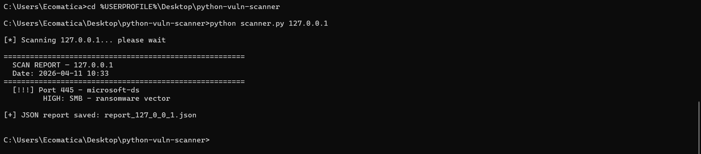
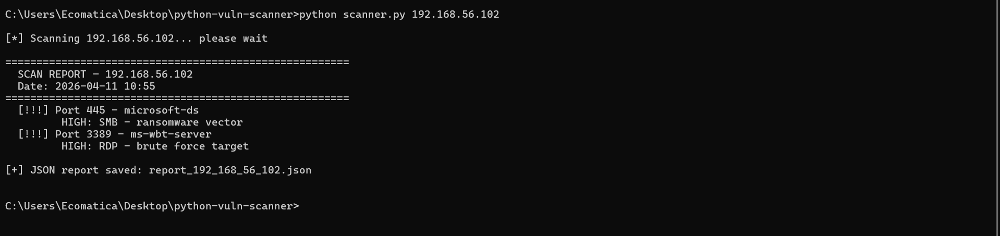

# Python port scanner with risk classification

A small Python tool that runs Nmap against a host, classifies the open ports by risk and saves the results as a JSON report. Part of my cybersecurity portfolio.

It rates exposure by port number. It does not test for vulnerabilities.

> Only scan machines you own or have written permission to test. I built and tested this against my own lab.

## What it does

- Scans nine common ports with service detection (`nmap -sV -T4`): 21, 22, 23, 25, 80, 443, 445, 3389 and 8080
- Classifies each open port:
  - High: 21 FTP, 23 Telnet, 445 SMB, 3389 RDP
  - Medium: 80 and 8080, unencrypted HTTP
  - Low: anything else, flagged for review
- Prints a report in the terminal and saves it as `report_<ip>.json`

## Requirements

- Python 3.8 or later
- Nmap installed ([nmap.org](https://nmap.org))
- The `python-nmap` library

## Installation

```bash
pip install -r requirements.txt
```

## Usage

```bash
python scanner.py <target_ip>
python scanner.py 192.168.56.102
```

## Example output

```text
[!!!] Port 3389 - ms-wbt-server
      HIGH: RDP - brute force target
[!!!] Port 445 - microsoft-ds
      HIGH: SMB - ransomware vector
```

Two sample reports are included: `report_127_0_0_1.json` and `report_192_168_56_102.json`.

## Screenshots





Juan Esteban Umaña Machado · linkedin.com/in/juanesumaa11
